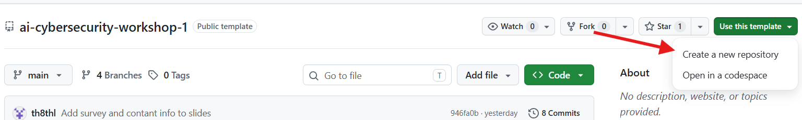
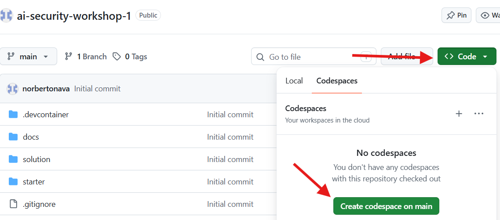
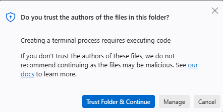
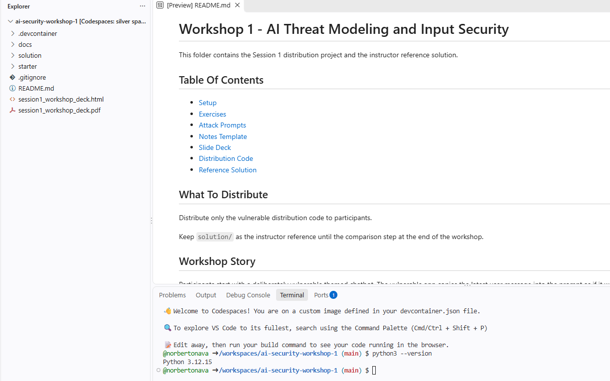

# GitHub Code Spaces Setup

GitHub Codespaces gives you a Linux development environment and VS Code in your browser. You do not need to install Python, Git, or VS Code on your computer. Commands below run in the **Codespaces terminal**, not your computer's terminal.

## 1. Before you start

You need a GitHub account, a Google account for the required Gemini API setup, internet access, a browser, and the workshop repository URL from your instructor. At the end of the workshop, you must push your work and stop your codespace (Step 8). Sign in to GitHub first. Codespaces availability depends on your account or organization policies and available usage allowance. Check [your Codespaces settings](https://github.com/settings/codespaces) before starting; if Codespaces is unavailable, use [Local setup](LOCAL_SETUP.md).

## 2. Create your own repository with the workshop code

Open the workshop template repository supplied by your instructor.

1. Click **Use this template**, then **Create a new repository**.
2. Set **Owner** to your own GitHub account.
3. Name the repository `ai-security-workshop-1`.
4. Choose **Public** for a portfolio, or **Private** if your instructor permits it.
5. Click **Create repository** and wait for the files to appear.



Confirm the repository header says **YOUR-USERNAME / ai-security-workshop-1** and contains `starter/`, `solution/`, and `docs/`. Use this repository for the remaining steps.

## 3. Start a codespace from your repository

1. On **your repository's** main page, click the green **Code** button.
2. Select the **Codespaces** tab.
3. Click **Create codespace on main** (the branch name may differ).




4. Wait for VS Code to open in your browser and for environment setup to finish. The repository already includes a dev container configuration that forwards port 8000 and requests dependency installation and database migrations. Click on the "Trust Folder & continue" if prompted




5. Open **Terminal > New Terminal** if a terminal is not already visible.



The terminal should start in the repository root. Verify:

```bash
pwd
ls
python3 --version
```

You should see `starter`, `solution`, and `docs`, and Python 3.11 or newer. If the folders are missing, open the repository root before continuing. Work in `starter/`; `solution/` is the reference solution.

## 4. Create your settings

The container installs dependencies automatically. From the repository root, open the app folder and create your settings file:

```bash
cd starter
cp .env.example .env
python -c "import secrets; print(secrets.token_urlsafe(50))"
```

Open `starter/.env` in the explorer and replace `DJANGO_SECRET_KEY` with the generated value. Keep the other template settings to start with. Keep `.env` private; never commit it or API keys.

No changes to Django's `settings.py` are part of the normal setup. If opening or using the app produces a hostname or CSRF error, see Troubleshooting below.

The container also runs database migrations during creation. Verify the app with:

```bash
python manage.py test
```

### Set up Gemini (required)

Complete this before starting the workshop exercises:

1. Open [Google AI Studio API keys](https://aistudio.google.com/apikey) and sign in with your Google account.
2. Complete any first-time account prompts.
3. Click **Create API key**. Select or create a project when prompted, then create and copy the key. If your account cannot create a project or key, ask your instructor for help.
4. Open `starter/.env` in Codespaces and set:

   ```dotenv
   GEMINI_API_KEY=paste-your-real-api-key-here
   ```

5. Keep `GEMINI_MODEL` and `GEMINI_FALLBACK_MODELS` as supplied in `.env.example`, unless your instructor specifies different models.
6. Save `.env`. If Django is already running, stop it with **Ctrl+C** and restart it with the command in Step 5.
7. Once the app is open, select **gemini** in the Provider dropdown and send a normal prompt, such as `Explain what a firewall is in one sentence.` Confirm you receive a response without a provider error. Resolve any key, model-access, or quota error with your instructor before proceeding.

Never commit the key or show it in screenshots. For Google's key creation instructions, see [Using Gemini API keys](https://ai.google.dev/gemini-api/docs/api-key).

### Verify the container's Ollama setup

Ollama is already installed in the workshop container; do not install it on your laptop or repeat its installation in Codespaces. In the Codespaces terminal, check:

```bash
ollama --version
ollama list
```

Test Qwen directly in the terminal using the model from the supplied `.env.example`:

```bash
ollama run qwen3:0.6b "Explain what a firewall is in one sentence."
```

You should receive a short answer. If your instructor changed `QWEN_MODEL` in `starter/.env`, use that model name in the command instead.

Confirm the model named by `QWEN_MODEL` in `starter/.env` appears in the list. Keep `QWEN_API_URL` as supplied in the template: Django and Ollama run in the same container, so the loopback address is appropriate. Once the app is open, select **qwen** and send a normal prompt to verify the integration.

If the Ollama command is missing, its server is unavailable, or the model is absent, share the container setup log with your instructor so they can check the environment provisioning.

## 5. Run and open the app

In the terminal, from `starter/`:

```bash
python manage.py runserver 0.0.0.0:8000
```

Leave this terminal running. Open the **Ports** panel beside the terminal. If port **8000** is missing, click **Forward a Port** and enter `8000`. Keep **Port Visibility** set to **Private**, then use the port's **Open in Browser** action. Sign in to GitHub if prompted.

Use the forwarded HTTPS address, rather than your computer's `localhost:8000`. This workshop app is intentionally vulnerable; keep the forwarded port private.


Select **mock** and send a normal prompt for a quick app check. Then complete the **gemini** and **qwen** verification steps above. Gemini setup is required. After verifying the providers, continue with the [workshop exercises](EXERCISES.md).

## 6. Resume work later

Go to [Your codespaces](https://github.com/codespaces) and reopen the existing codespace for your repository. In a new terminal at the repository root:

```bash
cd starter
python manage.py runserver 0.0.0.0:8000
```

Open port **8000** again. The container setup installs dependencies when the environment is created or rebuilt. If you create a different codespace, recreate `.env`; uncommitted `.env` and database files are not recovered from GitHub.

## 7. Commit and push your completed work

Saving a file in Codespaces does **not** push it to GitHub. Commit and push before finishing the workshop or deleting a codespace.

Stop Django with **Ctrl+C**. From the repository root (run `cd ..` if your terminal is still in `starter/`):

```bash
git remote -v
git status --short
git diff
```

Confirm `origin` points to **your** repository. Review the changed files. `.env`, `.venv/`, `db.sqlite3`, and `__pycache__/` should be ignored by the existing `.gitignore`. If any appear in the changes to be committed, stop and fix that before continuing. Do not stage real keys or private data.

Run verification from `starter/`, then return to the repository root:

```bash
cd starter
python manage.py test
cd ..
git add .
git diff --cached --stat
git diff --cached
```

Review the staged diff, then commit and push to the branch currently checked out:

```bash
git commit -m "Complete AI security workshop 1"
git push origin HEAD
```

Codespaces normally configures GitHub authentication for the repository you launched it from. If Git asks you to sign in, follow the browser prompt. If push is rejected because the remote has newer work, ask your instructor for help reconciling the changes; do not force push.

Open your repository on GitHub and select the same branch. Confirm your commit message and updated files appear. In the terminal, run:

```bash
git status
```

It should report a clean working tree. A clean tree alone does not prove the push succeeded: check the files on GitHub too. Submit your repository URL as directed by your instructor.


## 8. Stop the codespace (required before leaving)

**You must stop your codespace when we are done with the workshop.** First verify your changes are pushed to GitHub, then follow these steps:

1. Open [Your codespaces](https://github.com/codespaces).
2. Find the codespace for your workshop repository.
3. Open its **...** menu and select **Stop codespace**.
4. Confirm it is stopped before leaving.


Closing the browser tab alone does not immediately stop it. Stopped codespaces still occupy storage; delete one only after confirming all needed work is pushed or backed up. Ignored files such as `.env` and the SQLite database are not included in your push.

## Troubleshooting

- **DisallowedHost / invalid HTTP_HOST:** Copy the current port 8000 hostname into `DJANGO_ALLOWED_HOSTS` in `.env` and restart Django.
- **403 CSRF verification failed:** Reload the app using the Ports panel address and retry. If the error persists, share the exact error with your instructor so they can check the forwarded origin and proxy configuration. Do not disable CSRF middleware.
- **App does not open:** Keep the server running on `0.0.0.0:8000`, confirm port 8000 is forwarded, and open it through the Ports panel.
- **ModuleNotFoundError:** Check the container creation log for a failed dependency installation and share the error with your instructor.
- **Codespaces is unavailable:** Check your account allowance and organization policies, or use [Local setup](LOCAL_SETUP.md).

## GitHub documentation

- [Creating a repository from a template](https://docs.github.com/en/repositories/creating-and-managing-repositories/creating-a-repository-from-a-template)
- [Creating a codespace for a repository](https://docs.github.com/en/codespaces/developing-in-a-codespace/creating-a-codespace-for-a-repository)
- [Forwarding ports in your codespace](https://docs.github.com/en/codespaces/developing-in-a-codespace/forwarding-ports-in-your-codespace)
- [Using source control in your codespace](https://docs.github.com/en/codespaces/developing-in-a-codespace/using-source-control-in-your-codespace)


